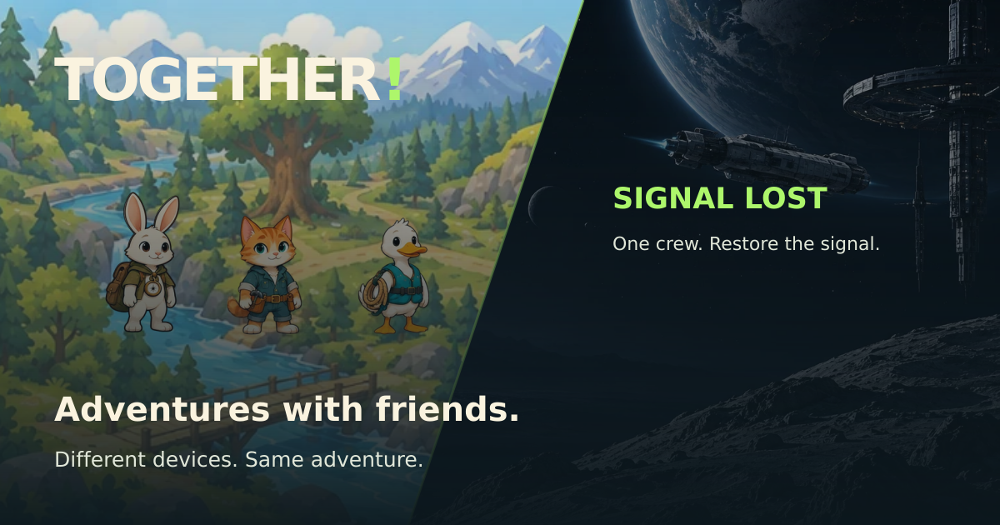

# TOGETHER! 🎮

### Different devices. Same adventure.

**A full-stack, real-time cooperative multiplayer game where the information is distributed, decisions are shared, and the server keeps everyone in sync.**

**2–6 players · Two game worlds · 15 playable experiences · No account required**

[**Play the live game**](https://together-multiplayer-game.onrender.com/) · [**Explore the source**](https://github.com/ElenkaSan/together-multiplayer-game) · [**Handshake AI Showcase**](https://app.joinhandshake.com/ai-showcase/projects/3705895)

---

## The idea

**What if the challenge in a multiplayer game wasn't competing against your friends, but figuring out how to succeed together?**

TOGETHER! is a browser-based cooperative experience designed for **2–6 people on independent devices**. One player creates a room, others join using a six-character code or invitation link, and the team works through scenarios in which each participant has different information or responsibilities.

The app is intentionally more than a collection of independent screens: it implements a **shared multiplayer state machine**, role-specific views, a validation layer, timed decisions, reconnect recovery, and synchronized results.

Built for the **Handshake “Create a Multiplayer Game” challenge** as an end-to-end full-stack engineering project.

## At a glance

| | |
| --- | --- |
| **Live application** | https://together-multiplayer-game.onrender.com/ |
| **Frontend** | React 19, TypeScript, Vite, responsive CSS, Framer Motion |
| **Backend** | Node.js, Express 5, Socket.IO |
| **Domain model** | Shared TypeScript game definitions plus server-side rules and puzzle generation |
| **Deployment** | Render, single Node service, HTTP health check |
| **Testing** | Node's test runner; unit, rule-engine, Socket.IO integration, regression and UI-contract tests |
| **Persistence** | Ephemeral in-memory rooms with anonymous seat restoration while the server stays alive |
| **Authentication** | No signup; room codes and opaque seat tokens, **not** user accounts |

## Two worlds, one multiplayer engine

### 🌿 Tiny Heroes — cooperative adventures

A family-friendly game in which a **Team Captain** and **Little Heroes** share clues, choose tools, plan routes, manage resources, and complete five stages per adventure.

**10 adventures:** Forest Rescue · Ice Rescue · Jungle Adventure · Treasure Island · Desert Rescue · Ocean Adventure · Magic Kingdom · Moon Mission · Cloud Adventure · Meadow Rescue.

The mechanics evolve across adventures: tool selection, limited shared Warm Packs, team stations, cooperative mechanisms, changing conditions, and progression tracking. The Captain doesn't automatically receive every helper's private clue: players explicitly communicate the information their team needs.

### 🚀 Signal Lost — a cooperative space mission

A five-sector mission for older players, with responsibilities distributed across **navigation, engineering, communications, and shared protection decisions**.

| Sector | Interactive mission environment | Cooperative challenge |
| --- | --- | --- |
| **01 · Wake the Relay** | Damaged station, antenna and signal visualization | Align receiver and signal settings using distributed measurements |
| **02 · Cross the Debris Field** | Interactive asteroid routes and flight visualization | Agree on a safe corridor using fuel, timing and protection readings |
| **03 · Power Failure** | Reactor and power-distribution network | Allocate a fixed budget of eight cells across four systems |
| **04 · The Ghost Telemetry** | Radar, sensors and diagnostics | Authenticate trustworthy telemetry against independent checks |
| **05 · Final Transmission** | Transmission array and crew confirmation indicators | Combine recovered records and align the final transmission |

Every crew member sees a **shared visual mission environment**, while their **private telemetry and permitted controls are role-specific**. Players can explicitly **Share with Crew**; proposed settings and locked orders are synchronized by the server.

For two-player games, responsibilities are combined. The same multiplayer system also accommodates larger crews.

> **Core design principle:** each crew member has only part of the evidence. The server generates puzzles whose combined evidence identifies a solution, rather than giving every player an obvious answer.

---

## System design

### Architecture

TOGETHER! runs as a **single Node.js service** serving the compiled frontend and coordinating real-time Socket.IO connections. The client renders the UI and expresses player intent. The server owns room state, validates actions, decides when phases change, and distributes **player-specific snapshots**.

~~~mermaid
flowchart TB
    subgraph Devices["Independent player devices (2–6)"]
        A["Player A · React UI"]
        B["Player B · React UI"]
        C["Additional players · React UI"]
    end

    subgraph Runtime["Node.js / Express + Socket.IO · Render"]
        Gateway["HTTP /health + static frontend\nSocket.IO command/ack gateway"]
        Engine["Authoritative room engine\nserver/engine.ts"]
        Mode["Mode orchestration and validators\nserver/modes.ts · server/*.ts"]
        Rooms[("In-memory room state\nseats · phases · deadlines · orders")]
        Views["Per-player snapshot projection\nshared board + authorized private clues"]
    end

    Rules["Shared TypeScript definitions\nshared/*.ts"]

    A & B & C <-->|"Commands / state events"| Gateway
    Gateway --> Engine
    Engine <--> Rooms
    Engine --> Mode
    Mode --> Rules
    Engine --> Views
    Views --> Gateway
    Rules -.->|"Public mission definitions"| Devices
~~~

### Why a server-authoritative model?

The browser must not be able to declare its own victory, reveal another player's telemetry, or advance a room independently.

Instead:

1. The **client submits intent** (ready, share, propose a setting, lock an order).
2. The **server verifies** the seat, current phase, puzzle identity, assigned controls, and allowed values.
3. The **engine updates one canonical room state**, if the command is valid.
4. Connected clients receive **new projections of that state**; the projection depends on who is asking.
5. The server resolves the round and advances the mission when its rules and deadlines allow.

This design provides one source of truth for players who act at different times, reconnect, or try to submit conflicting inputs.

### Real-time event flow

The Socket.IO gateway in [`server/index.ts`](server/index.ts) accepts a `command` event and acknowledges success or failure. The engine publishes `state` events to individual sockets, using a player-specific view rather than broadcasting the raw room object.

~~~mermaid
sequenceDiagram
    participant A as Navigator
    participant S as Authoritative server
    participant B as Engineer

    A->>S: create room
    S-->>A: room code + anonymous seat token
    B->>S: join with room code
    S-->>B: own seat token + own state
    A->>S: ready / start
    B->>S: ready
    S-->>A: phase + role-specific briefing
    S-->>B: phase + role-specific briefing
    A->>S: share-telemetry (selected observation)
    S-->>B: authorized shared observation
    B->>S: signal-draft (engineering setting)
    S-->>A: public proposal update
    A->>S: submit / lock orders
    B->>S: submit / lock orders
    S->>S: validate + resolve + advance phase
    S-->>A: personalized result snapshot
    S-->>B: personalized result snapshot
~~~

### Room lifecycle and state machine

The backend owns the state transition sequence:

~~~mermaid
stateDiagram-v2
    [*] --> lobby
    lobby --> briefing: host starts with 2+ ready players
    briefing --> action: briefing deadline
    action --> locked: orders complete or action deadline
    locked --> result: server resolves
    result --> briefing: next stage
    result --> finished: final stage
    briefing --> paused: insufficient connected players
    result --> paused: next stage needs players
    paused --> briefing: reconnect / enough players
    finished --> lobby: host replays
~~~

The engine also manages seat capacity, host transfer, room expiry, timeouts, duplicate submission rejection and stale-action validation. **A missing action is handled by server-side timing rules**, so one disconnected participant does not leave an active round indefinitely unresolved.

### Isolation, role permissions and information boundaries

A key engineering challenge was separating **what everyone should see** from **what only one player is allowed to know**.

| Information | Visibility |
| --- | --- |
| Current sector, shared environment, team progress and deadlines | Room-wide |
| Published equipment proposals and lock status | Room-wide |
| A player's assigned private telemetry and role tasks | That player's snapshot |
| A clue intentionally sent through Share with Crew | Authorized teammates |
| Internal puzzle solution, raw room state and other players' seat tokens | Server-only |

The server validates telemetry-sharing ownership and task assignments before accepting commands. Published shared-scene models deliberately omit private clues and puzzle answers. These boundaries are backed by privacy and Socket.IO tests.

**Security scope:** opaque seat tokens support anonymous reconnection, but they are not a substitute for accounts or a comprehensive security audit. Socket.IO commands also have input validation and basic per-connection request limiting.

### Designing puzzles that actually require cooperation

Signal Lost uses generated puzzle boards and **distributed telemetry**. The puzzle logic enumerates candidate setting combinations and checks them against the available evidence.

The validator checks for **one solution with the complete evidence**, and attempts to partition telemetry for crew sizes **2 through 6** so an individual assignment doesn't solve the puzzle by itself. Players must compare measurements, publish relevant evidence, and agree on orders.

That is an engineering constraint beyond a conventional multiple-choice game: the puzzle must remain internally consistent while roles and team sizes vary.

---

## Engineering decisions and trade-offs

| Decision | Why | Trade-off |
| --- | --- | --- |
| **Node.js + Socket.IO** | One runtime for browser coordination, room events and low-latency updates | Long-running server required |
| **Server-authoritative state** | Consistent rules, protected information and rejection of invalid or duplicate actions | More validation and state-machine complexity |
| **Shared TypeScript domain definitions** | Reuse game metadata across UI and backend | Requires discipline about public definitions versus secret server-side answers |
| **In-memory rooms** | Simple, low-cost, fast prototype without database setup | All active rooms disappear on process restart, redeploy or idle shutdown |
| **Anonymous reconnect tokens** | Players can refresh without registration | Restoration only works while the original room exists |
| **Room-scoped personalized snapshots** | Synchronizes public activity without exposing every player's private clues | Additional projection logic and privacy tests |
| **Responsive SVG mission scenes** | Visual feedback for the same shared state on multiple screen sizes | Extra small-screen, touch and accessibility validation |

This is an intentionally **single-instance architecture**, not a claim of durable or horizontally scalable infrastructure.

**Evolution path:** shared room storage and a Socket.IO adapter for multiple instances; persistent sessions if needed; richer observability and event tracing; expanded accessibility and mobile-device testing.

---

## Testing and quality engineering

The repository includes automated coverage for gameplay rules and network behavior, including:

- **Game engine:** room lifecycle, readiness, phase progression, timeouts, capacity and expiry.
- **Multiplayer integration:** independent Socket.IO clients, two- and six-player coordination, synchronized shared scenes, and five-sector Signal Lost completion.
- **Information privacy:** role-specific snapshots, selective clue sharing, telemetry boundaries and room isolation.
- **Reliability:** reconnect, seat restoration, host transfer, stale actions and duplicate submissions.
- **Gameplay:** Tiny Heroes adventure mechanics, progression, shared resources, retries and Signal Lost puzzle validity.
- **UI contracts:** interactive scene behavior, responsive layout helpers and regression checks.

The November 4, 2026 release verification reported **410/410 automated tests passing**, alongside live multiplayer QA and fixes for three confirmed interface defects. This is a recorded release result, **not** a claim that every browser, device or possible play sequence has been tested.

Tests based on Socket.IO clients verify protocol/game-state behavior; **they do not replace physical-device, Safari or full end-to-end browser testing**.

Run the current suite:

~~~bash
npm ci
npm test
npm run build
~~~

The build includes a TypeScript check and Vite production build.

---

## Run locally

**Prerequisite:** Node.js **22+** and npm.

~~~bash
npm ci
npm run build
npm start
~~~

Open **http://localhost:3000**.

For development, run the backend and frontend in separate terminals:

~~~bash
npm run server
~~~

~~~bash
npm run dev
~~~

Vite proxies Socket.IO traffic to the backend at port 3000. For multi-device LAN testing, use the host's reachable local address and ensure the ports/network allow connections.

## Production deployment

The app is deployed on **Render** as one Node web service. Configuration lives in [`render.yaml`](render.yaml):

| Setting | Value |
| --- | --- |
| Build command | `npm ci && npm run build` |
| Start command | `npm start` |
| Health check | `GET /health` |
| State storage | In-process memory |
| Browser assets | Vite-generated `dist/`, served by Express |

**Operational limitation:** rooms are ephemeral. A server restart, redeploy, or free-tier idle shutdown clears them. Reconnection restores a seat only while the original room remains in the same live process. This is an explicit architectural choice, not persistent session storage.

## Repository map

~~~text
src/                    React screens, shared visual scenes, responsive UI
  main.tsx              Application composition, Socket.IO client, reconnect
  RoomEntry.tsx         Entry, invites and lobby
  SignalMission.tsx     Shared space scenes and sector UI
  DebrisMission.tsx     Sector 2 route visualization and controls
  TinyHeroExperience.tsx
  TinyWorld.tsx         Family adventure UI and artwork
server/
  index.ts              HTTP + Socket.IO gateway and health endpoint
  engine.ts             Authoritative room state machine and snapshots
  modes.ts              Shared mode orchestration
  signal-puzzles.ts     Signal puzzle generation, evidence and validation
  tiny-adventures.ts    Tiny adventure resolution / presentation logic
shared/                 Public adventure definitions and shared types
tests/                  Rule engine, Socket.IO, gameplay and regression tests
public/art/             Game artwork and share images
render.yaml             Render production service configuration
~~~

## Try it with a friend

**[Launch TOGETHER!](https://together-multiplayer-game.onrender.com/)**

Choose **Tiny Heroes** or **Signal Lost**, create a room, and share the invite link or room code with another player. Both participants can join from separate browsers or devices without signing up.

There is **no built-in voice or free-form chat**. Gameplay provides specific **Share** actions for communicating clues and telemetry; players can also discuss strategy in person or using an external call.

---

**Built as a full-stack engineering challenge: real-time systems, cooperative game logic, responsive interfaces, and production delivery.**

[Live game](https://together-multiplayer-game.onrender.com/) · [Handshake Showcase](https://app.joinhandshake.com/ai-showcase/projects/3705895)

